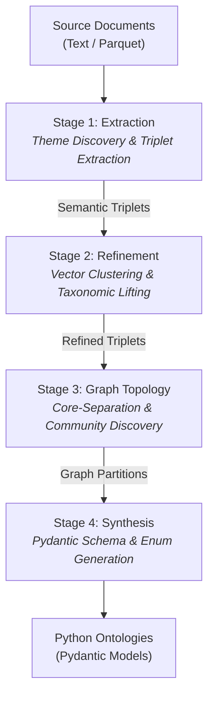

# SemanticPrism

SemanticPrism is an automated pipeline that transforms unstructured domain knowledge (such as clinical reports or technical documentation) into structured, deployable Python ontologies (Pydantic models).

Instead of generating schemas in a single LLM prompt—which often leads to hallucinations and overlapping concepts—SemanticPrism extracts atomic facts, groups them with vector clustering, maps them into mathematical graph networks, and uses topological boundaries to synthesize clean, modular data models.

---

## Pipeline Overview



---

## Quickstart

### Prerequisites
- **Python**: 3.10+
- **Local LLM**: [Ollama](https://ollama.com/) (e.g., `qwen2.5:7b`)

### Installation
```bash
git clone https://github.com/childmindresearch/SemanticPrism.git
cd SemanticPrism
pip install -r requirements.txt
```

### Running the Pipeline

Execute the full end-to-end pipeline:
```bash
python3 run_pipeline.py
```

Or run individual stages independently:
- **Stage 1 (Extraction)**: `python3 run_stage_1_extraction.py`
- **Stage 2 (Refinement)**: `python3 run_stage_2_refinement.py`
- **Stage 3 (Topology)**: `python3 run_stage_3_topology.py`
- **Stage 4 (Synthesis)**: `python3 run_stage_4_synthesis.py`

---

## Pipeline Stages

### Stage 1: Extraction
Ingests plain text files or Parquet datasets, identifies overarching domain themes, and extracts structured Subject-Predicate-Object (S-P-O) semantic triplets anchored to verbatim source quotes.

### Stage 2: Refinement
Encodes extracted entities and relations into vector embeddings, groups them into semantic clusters, and optionally maps terms into standardized taxonomic concepts using LLM hypernym resolution.

### Stage 3: Graph Topology
Builds a directed network graph from refined triplets, executes a 3-stage core-separation pipeline, and derives fine-grained thematic partitions:
- **Stage 3.1: Raw Graph Evaluation & Hub Identification**: Computes baseline metrics, degree distributions, and isolates systemic routers via participation coefficients and betweenness centrality.
- **Stage 3.2: Core-Periphery Separation**: Extracts the Hub Backbone Network to eliminate cross-domain modularity blur, doubling modularity $Q$ on the dense clustering substrate.
- **Stage 3.3: Community Discovery & Architectural Tiers**: Discovers fine-grained Leiden modules and derives hybrid geometric-topological architectural tiers (Nucleus, Mechanics, Modifiers) via degree-weighted Fréchet mean centroids and sentence grounding fidelity.

### Stage 4: Synthesis
Translates graph partitions and low-density nodes into deployable Python code:
- Generates Python `Enum` classes for orphan and boundary entities (`enums.py`).
- Synthesizes Pydantic `BaseModel` classes for qualified clusters.
- Consolidates schemas and formats the final `comprehensive_ontology.py` using Ruff.

---

## Configuration (`configs/`)

Pipeline behavior is configured via modular YAML files:

- **[configs/llm.yaml](configs/llm.yaml)**: Local Ollama model name, API endpoints, temperature, and context window limits.
- **[configs/io.yaml](configs/io.yaml)**: Ingestion source (`directory` vs. `parquet`), input/output paths, and resume modes (`skip` vs. `overwrite`).
- **[configs/refinement.yaml](configs/refinement.yaml)**: Embedding models, taxonomic lifting toggles, target theme count guidance, and clustering thresholds.
- **[configs/topology.yaml](configs/topology.yaml)**: Hub extraction thresholds, Leiden modularity resolution, architectural tier scoring weights, and tabular CSV export toggles.
- **[configs/synthesis.yaml](configs/synthesis.yaml)**: Minimum cluster sizes, hub target caps, and payload options.

---

## Output Structure (`outputs/`)

```text
outputs/
├── 01_extraction/          # Raw triplets, discovered themes, and master theme mappings
├── 02_refinement/          # Refined triplets, vector cluster mappings, taxonomic maps & fidelity diagnostics
├── 03_topology/            # Stage 3 Topology: 3-stage modular architecture, interactive HTML visuals & diagnostics
│   ├── 01_raw_graph_evaluation/   # Raw graph metrics, hub registry & global topology visuals
│   ├── 02_core_separation/        # Reduced core metrics, hub backbone & pruning breakdown
│   ├── 03_paths/
│   │   └── community/             # Leiden partitions, architectural tiers, diagnostics & payload gallery
│   └── topology_metrics_comparative_summary.csv # Cross-stage macro topological benchmarks
├── 04_synthesis/           # Generated Pydantic schemas, enums, and comprehensive ontologies
└── payload_text/           # Centralized record of prompts and payloads sent to the LLM
```
