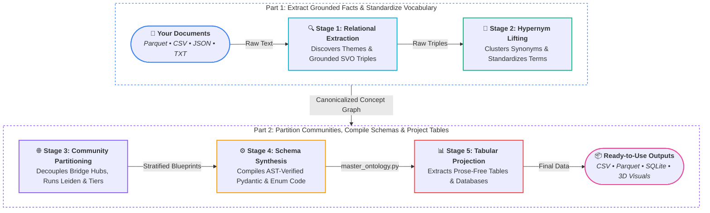

# SemanticPrism

[](LICENSE)
[](pyproject.toml)

**SemanticPrism** is an unsupervised, local-first neuro-symbolic pipeline that compiles unstructured narrative documents—such as clinical notes, research papers, incident reports, or behavioral evaluations—into **validated Python data schemas** (`Pydantic` `BaseModel` and `Enum` classes) and **prose-free relational tables** (`CSV`, `Parquet`, and `SQLite`).

Instead of prompting a single language model to read long documents and invent columns ad hoc (which causes schema drift, hallucinated fields, and uncalibrated predictions), SemanticPrism coordinates local open-weight language models with deterministic embedding, graph-partitioning, and AST compiler safeguards across **five modular stages**.

---

## How the 5 Stages Fit Together



---

## Quickstart

### 1. Install
Requires **Python 3.10+** and a GPU (NVIDIA CUDA or Apple Silicon recommended for local AI inference, powered by [PrismRunner](https://github.com/childmindresearch/PrismRunner)).

```bash
git clone https://github.com/childmindresearch/SemanticPrism.git
cd SemanticPrism
pip install -r requirements.txt
```

### 2. Edit `model_config.py` (One-Stop Setup)
Open **[model_config.py](model_config.py)** in the root directory. Your local AI models and input paths live in four clean sections:

```python
# 1. Optional Hugging Face token (for faster model downloads)
HF_TOKEN = None

# 2. AI Models (uncomment a smaller preset in model_config.py if using an 8–60 GB GPU)
MODEL_NAME = "Qwen/Qwen3.6-27B"                    # Reads text & extracts data (Stages 1, 2 & 5)
EMBEDDING_MODEL = "BAAI/bge-large-en-v1.5"         # Measures similarity between concepts (Stages 1–3)
CODER_MODEL = "Qwen/Qwen2.5-Coder-32B-Instruct"    # Writes Python schemas (Stage 4)

# 3. Stage 1 Discovery Dataset (documents used in Stages 1–4 to discover topics & design schemas)
INPUT_PATH = "inputs/testdocs.parquet"             # .parquet, .csv, .json, .jsonl, or folder of .txt files
ID_COLUMN = "unique_val"                           # Column with unique document IDs
TEXT_COLUMN = "report"                             # Column with document text
DOCUMENT_LIMIT = None                              # Optional cap (e.g. 100 for a quick test; None = all)

# 4. Stage 5 Extraction Dataset (documents projected into final CSV/Parquet/SQLite tables)
STAGE5_INPUT_PATH = "inputs/testdocs.parquet"      # Same dataset as Stage 1, or a separate/larger cohort
STAGE5_ID_COLUMN = "unique_val"
STAGE5_TEXT_COLUMN = "report"
STAGE5_DOCUMENT_LIMIT = None
STAGE5_SCHEMA_PATH = "outputs/04_synthesis/schemas/master_ontology.py"
STAGE5_EXTRACT_MODE = "unified"                    # "unified" (recommended), "top_level", "child", or "all"
STAGE5_INCLUDE_SOURCE_TEXT = False                 # False = keeps consolidated_wide prose-free by default
```

> **Note on Sample Data (`inputs/`):** All 15 sample clinical evaluation documents in `inputs/testdocs.parquet` and `inputs/testdocs/doc1..5.txt` are **100% synthetic, fictional mock reports** generated solely for testing and demonstration. They contain zero real patient or Protected Health Information (PHI).

#### Helpful Notes on `model_config.py`:
- **Hardware Presets (`8 GB` to `80 GB+` VRAM)**: `model_config.py` includes ready-to-uncomment presets for **8–12 GB** laptops, **16–24 GB** workstations, **48–60 GB** servers, and **80 GB+** servers (default). If the Stage 4 coding model ever exceeds available GPU memory, SemanticPrism automatically switches to 4-bit quantization or a smaller backup model.
- **Separating Discovery from Deployment**: You can induce your ontology on an unlabeled discovery sample in Stages 1–4 (`INPUT_PATH`), then run Stage 5 (`STAGE5_INPUT_PATH`) across thousands of held-out documents—or bring your own custom `.py` Pydantic schema directly into Stage 5.
- **Privacy-by-Default Exports**: `STAGE5_INCLUDE_SOURCE_TEXT = False` omits raw `source_text` from `consolidated_wide.csv` / `.parquet` / `aggregated_data.db` so exported tables remain detached from verbatim narrative text unless you explicitly pass `--include-source-text` or set `True`.

### 3. Run the Pipeline

**Run all 5 stages from start to finish:**
```bash
python3 run_pipeline.py
```

**Run specific stages (for example, just Stages 4 and 5):**
```bash
python3 run_pipeline.py --stages 4 5
```

**Or run any single stage standalone:**
```bash
python3 run_stage_1_extraction.py   # Stage 1: Relational Extraction
python3 run_stage_2_refinement.py   # Stage 2: Hypernym Lifting
python3 run_stage_3_topology.py     # Stage 3: Community Partitioning & 3D Visuals
python3 run_stage_4_synthesis.py    # Stage 4: Schema Synthesis (master_ontology.py)
python3 run_stage_5_mapping.py      # Stage 5: Tabular Projection (CSV, Parquet & SQLite)
```

---

## What Happens in Each Stage

SemanticPrism adapts automatically to short notes, specialized technical prose, and multi-page clinical evaluations without manual threshold tuning.

### Stage 1: Relational Extraction (`src/extraction/`)
Scans documents in two passes—first discovering corpus-wide master themes, then extracting **Subject – Predicate – Object** triples anchored to exact source quotes.
- **Model-Aware, Structure-Preserving Chunking**: Scales chunk windows and token budgets to match your chosen model while preserving section headers, lists, and carry-over entity context.
- **Small-Model Recovery**: Salvages valid propositions from truncated outputs, splits dense failed passages for clean retries, and deduplicates across chunk boundaries.

### Stage 2: Hypernym Lifting (`src/refinement/`)
Resolves synonym fragmentation (for example, unifying *"heart attack"* and *"myocardial infarction"*) through dimension-calibrated UMAP + HDBSCAN micro-clustering, agglomerative macro-linkage, and batched LLM hypernym synthesis.
- **Role-Aware Vocabulary Consolidation**: Clusters Subjects, Predicates, and Objects independently while passing singletons through with zero LLM overhead.
- **Contextual Grounding Check**: Scores every canonicalized triple via cosine similarity against its original source sentence ($\gamma_e$).

### Stage 3: Community Partitioning (`src/topology/`)
Assembles canonicalized triples into a concept graph and isolates cohesive domain modules using deterministic graph math (zero LLM calls).
- **Participation-Guided Bridge-Hub Decoupling**: Separates ubiquitous pan-corpus connectors (such as *"patient"* or *"person"*) via degree prominence, geodesic betweenness, and Guimerà–Amaral thematic participation ($P_i$) while preserving genuine domain anchors.
- **Hybrid Leiden & Boundary Refinement**: Optimizes hybrid semantic-structural modularity, realigns misplaced boundary concepts, and stratifies each community into three prominence tiers ($S_u$: *Tier 1 Nucleus*, *Tier 2 Mechanics*, *Tier 3 Modifiers*).
- **Interactive Browser Visuals**: Exports standalone HTML network and 3D manifold explorers to `outputs/03_topology/visuals/`.

### Stage 4: Schema Synthesis (`src/synthesis/`)
Compiles each stratified community blueprint into executable Python data models (`Pydantic` v2 `BaseModel` and `(str, Enum)` classes) consolidated into **`outputs/04_synthesis/schemas/master_ontology.py`**.
- **Bounded Clinical & Analytical Primitives**: Prioritizes closed `Enum` vocabularies (each with a guaranteed `OTHER = "Other"` fallback), `bool` indicators, and typed numeric scalars (`int`, `float`).
- **Deterministic AST Sanitizer**: Collapses repetitive prefix/suffix field lists, deduplicates overlapping classes across communities, enforces field/member caps (`15` by default), and verifies runtime `exec()` validity.

### Stage 5: Tabular Projection (`src/mapping/`)
Maps document collections against `master_ontology.py` to populate structured relational databases and wide feature matrices.
- **Unified Envelope & Relevance Triage**: Populates compact ontologies in a single pass per chunk, and automatically applies fast chunk-level relevance triage when ontologies contain 6+ root schemas.
- **Live Checkpoint Resume**: Saves progress per chunk and document; re-running automatically resumes from `.completed.json` markers (pass `--overwrite` to rebuild from scratch).
- **Multi-Format Relational Exports**: Writes parent/child CSV tables, a 1-row-per-document wide matrix (`consolidated_wide.csv` and `consolidated_wide.parquet`), and a SQLite database (`aggregated_data.db`).

---

## Key Output Files

| File / Folder | What It Contains |
| :--- | :--- |
| `outputs/SemanticPrism_OntologyBuild.txt` | Pre-Stage-5 summary of Stages 1–4 ontology discovery, graph compression, and compiled classes. |
| `outputs/pipeline_summary.txt` | End-to-end report of models used, runtime, discovered schemas, and Stage 5 table dimensions (`pipeline_summary.json` for machine reading). |
| `outputs/03_topology/visuals/*.html` | Interactive HTML network visuals, including `cluster_3d_galaxy_visualization.html` and `reduced_core_graph.html`. |
| `outputs/04_synthesis/schemas/master_ontology.py` | Consolidated, AST-verified Python `Pydantic` & `Enum` ontology. |
| `outputs/05_extraction/aggregated_tables/consolidated_wide.csv` | **Main wide table**: 1 row per document across all schemas (also saved as `.parquet`, prose-free by default). |
| `outputs/05_extraction/aggregated_tables/aggregated_data.db` | SQLite database containing normalized parent/child tables plus `consolidated_wide`. |

---

## Optional Advanced Configuration

| File | What It Controls |
| :--- | :--- |
| **[model_config.py](model_config.py)** | **Main setup**: AI models, optional Hugging Face token, Stage 1 discovery dataset, and Stage 5 extraction settings. |
| **[configs/topology.yaml](configs/topology.yaml)** | Stage 3 granularity (`"macro"`, `"balanced"`, or `"granular"`), hub pruning, boundary refinement, and visual settings. |
| **[configs/AST_toggle.py](configs/AST_toggle.py)** | Stage 4 AST sanitization switches and max field/enum caps. |
| **[docs/Custom_Process.md](docs/Custom_Process.md)** & **[docs/AST_Sanitization_Rules.md](docs/AST_Sanitization_Rules.md)** | Mathematical formulations across Stages 1–4 and AST sanitization specifications. |

---

## Project Layout

```text
SemanticPrism/
├── model_config.py             # Main configuration (models & datasets for Stages 1–4 and Stage 5)
├── configs/
│   ├── topology.yaml           # Stage 3 community partitioning, hub decoupling & visual settings
│   └── AST_toggle.py           # Stage 4 AST sanitization switches & field/enum caps
├── docs/                       # Mathematical & AST reference documentation
├── inputs/                     # Synthetic mock evaluation documents for quickstart testing
├── src/                        # Modular stage implementations
│   ├── extraction/             # Stage 1: Relational Extraction
│   ├── refinement/             # Stage 2: Hypernym Lifting
│   ├── topology/               # Stage 3: Community Partitioning
│   ├── synthesis/              # Stage 4: Schema Synthesis
│   └── mapping/                # Stage 5: Tabular Projection
├── tests/                      # Fast CPU unit tests (AST sanitizer, aggregator, topology tiering)
├── run_pipeline.py             # End-to-end orchestrator & summary builder
└── run_stage_1..5_*.py         # Standalone stage entrypoints
```

---

## Citation

If you use **SemanticPrism** in your research, please cite:

```bibtex
@article{semanticprism2026,
  title   = {Semantic Prism: Unsupervised, Local-First Neuro-Symbolic Schema Induction for Text-to-Table Extraction},
  author  = {LoBue, David and {Child Mind Institute}},
  year    = {2026},
  url     = {https://github.com/childmindresearch/SemanticPrism}
}
```
