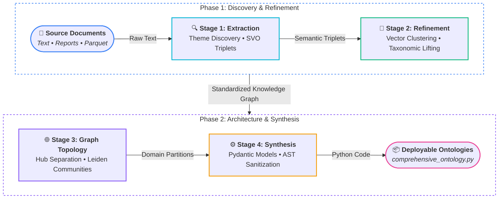

# SemanticPrism

SemanticPrism is an automated knowledge engineering pipeline that transforms unstructured domain text (such as clinical reports, research papers, or technical documents) into strictly typed, production-ready Python ontologies (`Pydantic v2` models and `Enum` classes).

Instead of relying on a single monolithic LLM prompt—which often hallucinates or tangles concepts—SemanticPrism separates **LLM reasoning** (fact extraction, concept naming, and code synthesis) from **deterministic math and graph algorithms** (vector clustering, network topology, and AST code sanitization).

---

## Pipeline Overview



---

## Quickstart

### 1. Prerequisites
- **Python**: 3.10+
- **LLM Backend**: Powered by `PrismRunner` (loads local HuggingFace LLMs and `SentenceTransformer` embedding models configured in **[model_config.py](model_config.py)**).

### 2. Installation
```bash
git clone https://github.com/childmindresearch/SemanticPrism.git
cd SemanticPrism
pip install -r requirements.txt
```

### 3. Configure Models & Input Dataset (`model_config.py`)
Edit **[model_config.py](model_config.py)** in the root directory to set your models and input data in one place:
```python
MODEL_NAME = "Qwen/Qwen2.5-3B-Instruct"          # Used in Stages 1 & 2
EMBEDDING_MODEL = "all-MiniLM-L6-v2"             # Used in Stages 1, 2 & 3
CODER_MODEL = "Qwen/Qwen2.5-Coder-7B-Instruct"   # Used in Stage 4

INPUT_PATH = "inputs/testdocs.parquet"           # Path to dataset or folder of .txt files
ID_COLUMN = "unique_val"                         # Document ID column
TEXT_COLUMN = "report"                           # Raw text column
DOCUMENT_LIMIT = None                            # Optional cap on documents (None = all)
```

### 4. Run the Pipeline
Run the complete 4-stage pipeline end-to-end (automatically generates `outputs/pipeline_summary.txt` and `outputs/pipeline_summary.json` upon completion):
```bash
python3 run_pipeline.py
```

Or run any stage individually:
```bash
python3 run_stage_1_extraction.py   # Stage 1: Theme & Triplet Extraction
python3 run_stage_2_refinement.py   # Stage 2: Embedding Clustering & Taxonomic Lifting
python3 run_stage_3_topology.py     # Stage 3: Graph Architecture & Community Detection
python3 run_stage_4_synthesis.py    # Stage 4: Pydantic & Enum Code Generation
python3 run_pipeline.py --summary-only  # Regenerate pipeline_summary.txt from existing outputs
```

---

## How Each Stage Works (Key Processes)

SemanticPrism uses self-calibrating, multi-variable algorithms at every stage so you do not have to hand-tune thresholds when switching datasets or embedding models. For full mathematical details, see **[docs/Custom_Process.md](docs/Custom_Process.md)**.

### Stage 1: Extraction (`src/extraction/`)
Reads raw text or Parquet files, discovers overarching themes, and extracts Subject-Predicate-Object (S-P-O) facts anchored to verbatim source quotes.
- **Self-Calibrating Manifold Clustering**: Automatically adapts similarity cutoffs to the background distribution of your embedding model so theme clusters neither collapse into one giant group nor shatter into singletons.
- **Leave-One-Out (LOO) Centroid Scoring & Dual-Gate Confidence**: Removes small-cluster self-bias when measuring how well a theme fits its cluster, classifying each theme into `high`, `medium`, `low`, or `unassigned` confidence bands.
- **Core-Gated MMR Selection**: Uses Maximal Marginal Relevance (MMR) to select cluster exemplars that are both highly representative (central) and semantically diverse, preventing near-duplicate themes from crowding the LLM prompt.

### Stage 2: Refinement (`src/refinement/`)
Embeds extracted Subjects, Predicates, and Objects into vector space, groups synonymous terms, and lifts them into clean taxonomic concepts.
- **Adaptive Distance Cutoffs & UMAP Sizing**: Dynamically scales UMAP neighborhood sizes to match vocabulary size and calibrates outlier-rescue and cluster-merging thresholds separately for nouns (`Subject`/`Object`) vs. verbs (`Predicate`).
- **Frequency-Weighted Spherical Centroids & Seeded MMR Packing**: Weights terms by log-dampened corpus frequency to find the best representative label for each cluster, and packs LLM context windows in diversity-ranked order.
- **Contextual Grounding Fidelity ($\gamma_e$)**: Scores every refined triplet against its original verbatim source quote via cosine similarity so downstream stages know how closely each concept remains grounded in the source text.

### Stage 3: Graph Topology (`src/topology/`)
Constructs a knowledge graph from refined triplets and partitions it into cohesive domain modules.
- **Core-Periphery Hub Separation**: Identifies generic, high-traffic "hub" concepts (using Participation Coefficients and Betweenness Centrality) and moves them out of the core graph into shared `enums.py` vocabularies so they don't blur domain boundaries.
- **Hybrid Leiden Clustering & Agglomeration**: Combines graph edge weights with embedding cosine similarity to discover fine-grained communities, then merges tightly related micro-clusters into coherent macro-domains.
- **Architectural Tier Scoring**: Ranks entities within each community (using centrality, prototypicality, and source fidelity) into **Tier 1: Core Models**, **Tier 2: Domain Fields**, and **Tier 3: Modifiers**.
- **Interactive 3D Visuals**: Exports standalone HTML dashboards (`cluster_3d_galaxy_visualization.html`, `stage_04_llm_payload_gallery.html`) for inspecting the graph.

### Stage 4: Synthesis (`src/synthesis/`)
Translates each graph community into clean, validated Python `Enum` and `Pydantic BaseModel` classes, then merges them into `comprehensive_ontology.py`.
- **Cross-Cluster C-TF-IDF Domain Ranking**: Identifies the top 5 signature terms that uniquely define a community while penalizing generic terms that appear across multiple communities.
- **Fidelity & Entity-Overlap Sentence Ranking**: Selects the most relevant source sentences for LLM synthesis by combining Stage 2 grounding fidelity ($\gamma_e$) with the density of community entities in each sentence.
- **Multi-Criteria AST Sanitization & Entropy Collapse**: Parses generated Python code through an Abstract Syntax Tree (AST) sanitizer that automatically:
  - Collapses repetitive runs of prefixed/suffixed fields (e.g., `item_a`, `item_b`, `item_c`) into clean list fields (`items: Optional[List[str]]`).
  - Strips narrative sentence dumps, bloated enums, and boolean checklists.
  - Prioritizes and caps models at 15 core fields (`MAX_BASEMODEL_FIELDS_PER_CLASS`) and enums at 20 members (`MAX_ENUM_MEMBERS_PER_CLASS`).
- **Multi-Signal Module Disambiguation**: Resolves duplicate module filenames using a 4-step cascade (LLM name $\rightarrow$ primary `BaseModel` class $\rightarrow$ C-TF-IDF domain term $\rightarrow$ compound class name).

---

## Configuration

All key settings are centralized for quick customization:

| Config File | Purpose |
| :--- | :--- |
| **[model_config.py](model_config.py)** | **Master configuration**: Set `MODEL_NAME` (Stages 1 & 2), `EMBEDDING_MODEL` (Stages 1–3), `CODER_MODEL` (Stage 4), and input dataset settings (`INPUT_PATH`, `ID_COLUMN`, `TEXT_COLUMN`, `DOCUMENT_LIMIT`). |
| **[configs/topology.yaml](configs/topology.yaml)** | Stage 3 graph architecture settings: macro granularity dials, hub separation sensitivity, Leiden resolution, community merging thresholds, and HTML visualization toggles. |
| **[configs/AST_toggle.py](configs/AST_toggle.py)** | Stage 4 AST sanitization controls: centralized `True`/`False` switches and numerical limits (e.g., max fields per model, max enum members) for every code sanitization rule. |
| **Stage Runner Scripts (`run_stage_1..4_*.py`)** | Advanced per-stage hardware, batching, chunking, and token limit variables at the top of each runner script. |

---

## Project Layout

```text
SemanticPrism/
├── model_config.py             # Master model & input dataset configuration
├── configs/                    # Stage 3 topology.yaml & Stage 4 AST_toggle.py
│   ├── topology.yaml           # Graph partitioning & 3D visual configuration
│   └── AST_toggle.py           # True/False toggles & limits for Stage 4 AST rules
├── docs/                       # Detailed technical documentation
│   ├── Custom_Process.md       # Multi-variable scoring, ranking & filtering reference
│   └── AST_Sanitization_Rules.md # Complete guide to Stage 4 AST code sanitization rules
├── src/                        # Modular stage packages
│   ├── extraction/             # Stage 1: Theme discovery & S-P-O extraction
│   ├── refinement/             # Stage 2: Vector clustering & taxonomic lifting
│   ├── topology/               # Stage 3: Graph hub separation & Leiden communities
│   └── synthesis/              # Stage 4: Pydantic synthesis & AST sanitization
├── outputs/                    # Generated artifacts for Stages 01–04 & LLM payload logs
├── run_pipeline.py             # Master end-to-end pipeline runner
└── run_stage_1..4_*.py         # Individual stage entrypoints
```
