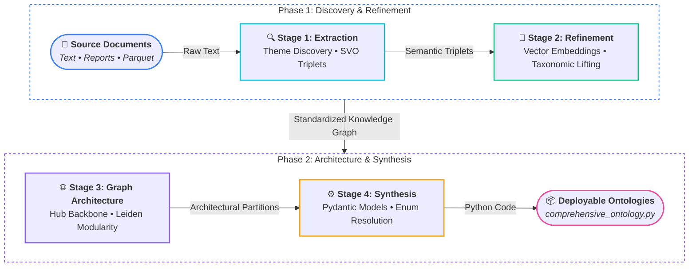

# SemanticPrism

SemanticPrism is an automated knowledge engineering pipeline that transforms unstructured domain text (such as clinical reports or technical documentation) into strictly typed, production-ready Python ontologies (Pydantic v2 BaseModel classes and Enum definitions).

Rather than generating models through a single monolithic prompt—which risks hallucination and tangled cross-domain concepts—SemanticPrism enforces a strict decoupling between non-deterministic LLM operations (extraction, taxonomic reasoning, code synthesis) and deterministic mathematical/graph-theoretic operations (vector embeddings, spherical clustering, core-periphery separation, and Leiden community detection).

---

## Pipeline Overview



---

## Quickstart

### Prerequisites
- **Python**: 3.10+
- **Local LLM**: [Ollama](https://ollama.com/) (e.g., `qwen2.5:7b`)

### Installation
```bash
git clone https://github.com/childmindresearch/SemanticPrism.git
cd SemanticPrism
pip install -r requirements.txt
```

### Running the Pipeline

Execute the full end-to-end pipeline:
```bash
python3 run_pipeline.py
```

Or run individual stages independently:
- **Stage 1 (Extraction)**: `python3 run_stage_1_extraction.py`
- **Stage 2 (Refinement)**: `python3 run_stage_2_refinement.py`
- **Stage 3 (Graph Architecture)**: `python3 run_stage_3_topology.py`
- **Stage 4 (Synthesis)**: `python3 run_stage_4_synthesis.py`

---

## Pipeline Stages

### Stage 1: Extraction
Ingests plain text files or Parquet datasets, identifies overarching domain themes, and extracts structured Subject-Predicate-Object (S-P-O) semantic triplets anchored to verbatim source quotes.

### Stage 2: Refinement
Encodes extracted entities and relations into vector embeddings, groups them into semantic clusters, and optionally maps terms into standardized taxonomic concepts using LLM hypernym resolution.

### Stage 3: Graph Architecture
Builds a directed network graph from refined triplets, executes a 3-stage core-separation pipeline, and derives fine-grained thematic partitions:
- **Stage 3.1: Raw Graph Evaluation & Hub Identification**: Computes baseline metrics, degree distributions, and isolates systemic routers via participation coefficients and betweenness centrality.
- **Stage 3.2: Core-Periphery Separation**: Extracts the Hub Backbone Network to eliminate cross-domain modularity blur, doubling modularity $Q$ on the dense clustering substrate.
- **Stage 3.3: Community Discovery & Agglomeration**: Discovers fine-grained Leiden modules, derives architectural tiers (Nucleus, Mechanics, Modifiers), and executes multi-pass semantic agglomeration to merge high-cosine-similarity centroids into macro-domains.
- **Interactive Visual Suite**: Generates self-contained HTML dashboards (`cluster_3d_galaxy_visualization.html`, `stage_04_llm_payload_gallery.html`, `isolated_communities_only.html`) with in-page toggles to compare raw Leiden baseline partitions against agglomerated macro-domains.

#### Mathematical & Geometric Foundation
SemanticPrism replaces ad-hoc graph clustering with a mathematically rigorous, 4-step geometric and topological pipeline:

1. **Hyperspherical Representation & Debiasing ($\mathbb{S}^{D-1}$)**
   * **$L_2$ Normalization:** All embeddings satisfy $\|e_v\|_2 = 1.0$, rendering dot products identical to cosine similarity: $\langle u, v \rangle = \cos(\theta_{uv})$.
   * **All-but-the-Top Centering:** Removes corpus mean anisotropy ($\hat{v} = \frac{v - \mu}{\|v - \mu\|_2}$), preventing multi-concept centroids from collapsing into the global background cone.
   * **Spherical Fréchet Centroids:** Computes true centers of mass on the hypersphere: $\mu_C = \frac{\sum_{v \in C} \hat{v}}{\|\sum_{v \in C} \hat{v}\|_2}$.

2. **Topological Core-Separation & Hub Quarantining**
   * **Reciprocal Edge Evidence:** Sums bidirectional statement support: $w(u, v) = w_{\text{dir}}(u, v) + w_{\text{dir}}(v, u)$.
   * **Systemic Hub Extraction:** Prunes high-degree routers using **Participation Coefficients** ($P_i = 1 - \sum_m (k_{im}/k_i)^2 \ge 0.70$) and deterministic **Betweenness Centrality** ($C_B(v)$). Hubs are strictly quarantined to `enums.py`, decoupling modular community structure.

3. **Multi-Pass Community Optimization & Agglomeration**
   * **Hybrid Leiden Modularity:** Maximizes modularity $Q$ on the dense core ($d > 1$) with strictly positive hybrid weights: $w_{\text{hybrid}} = w \cdot [(1 - \alpha) + \alpha \max(\text{floor}, \cos \theta)]$.
   * **Guarded Absorption & Harvesting:** Reattaches degree-1 leaves and singletons based on centroid affinity and contrast margins ($\Delta_{\text{contrast}} \ge 0.05$).
   * **Hierarchical Agglomeration:** Iteratively merges communities with high centroid cosine similarity ($\tau_{\text{agglom}} \ge 0.85$) into cohesive macro-domains.

4. **Architectural Tier Partitioning (Synthesis Grounding)**
   * Computes a Cobb-Douglas composite score for every entity $u \in C$:
     $$S_u = \left[\max(0.001, P_u)\right]^{0.40} \cdot \left[D_u\right]^{0.40} \cdot \left[\Gamma_u\right]^{0.20}$$
     *(where $P_u$ is centroid prototypicality, $D_u$ is internal degree centrality, and $\Gamma_u$ is source fidelity)*.
   * Stratifies entities into **Tier 1: Thematic Nuclei** (BaseModel classes), **Tier 2: Relational Mechanics** (domain fields), and **Tier 3: Contextual Modifiers** (metadata nuances).

### Stage 4: Synthesis
Translates graph partitions and low-density nodes into deployable Python code:
- Generates Python `Enum` classes for orphan and boundary entities (`enums.py`).
- Synthesizes Pydantic `BaseModel` classes for qualified clusters.
- Consolidates schemas and formats the final `comprehensive_ontology.py` using Ruff.

---

## Configuration (`configs/`)

Pipeline behavior is configured via modular YAML files:

- **[configs/llm.yaml](configs/llm.yaml)**: Local Ollama model name, API endpoints, temperature, and context window limits.
- **[configs/io.yaml](configs/io.yaml)**: Ingestion source (`directory` vs. `parquet`), input/output paths, and resume modes (`skip` vs. `overwrite`).
- **[configs/refinement.yaml](configs/refinement.yaml)**: Embedding models, taxonomic lifting toggles, target theme count guidance, and clustering thresholds.
- **[configs/topology.yaml](configs/topology.yaml)**: Hub extraction thresholds, Leiden modularity resolution, agglomeration similarity thresholds (macro-domain fusion), architectural tier scoring weights, and tabular CSV export toggles.
- **[configs/synthesis.yaml](configs/synthesis.yaml)**: Minimum cluster sizes, hub target caps, and payload options.

---

## Output Structure (`outputs/`)

```text
outputs/
├── 01_extraction/          # Raw triplets, discovered themes, and master theme mappings
├── 02_refinement/          # Refined triplets, vector cluster mappings, taxonomic maps & fidelity diagnostics
├── 03_topology/            # Stage 3 (Graph Architecture): 3-stage modular architecture, interactive HTML visuals & diagnostics
│   ├── 01_raw_graph_evaluation/   # Raw graph metrics, hub registry & global topology visuals
│   ├── 02_core_separation/        # Reduced core metrics, hub backbone & pruning breakdown
│   ├── 03_paths/
│   │   └── community/             # Leiden partitions, architectural tiers, diagnostics & payload gallery
│   └── topology_metrics_comparative_summary.csv # Cross-stage macro topological benchmarks
├── 04_synthesis/           # Generated Pydantic schemas, enums, and comprehensive ontologies
└── payload_text/           # Centralized record of prompts and payloads sent to the LLM
```
