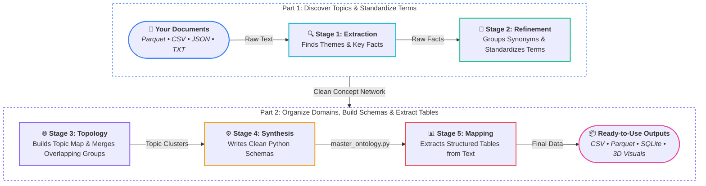

# SemanticPrism

**SemanticPrism** automatically turns unstructured documents—such as clinical notes, research papers, incident reports, or policy documents—into **clean Python data schemas** (`Pydantic` models) and **ready-to-use spreadsheets and databases** (`CSV`, `Parquet`, and `SQLite`).

Instead of asking a single AI prompt to read everything and invent a database at once (which often leads to missing details or made-up categories), SemanticPrism breaks the job into **five clear stages**. AI models handle reading text and writing schemas, while reliable math and graph steps organize topics, merge duplicates, and verify every rule.

---

## How the 5 Stages Fit Together



---

## Quickstart

### 1. Install
Requires **Python 3.10+** and a GPU (NVIDIA CUDA or Apple Silicon recommended for local AI models).

```bash
git clone https://github.com/childmindresearch/SemanticPrism.git
cd SemanticPrism
pip install -r requirements.txt
```

### 2. Edit `model_config.py` (One-Stop Setup)
Open **[model_config.py](model_config.py)** in the main folder. Everything you need to change—your AI models and your input files—lives in four simple sections:

```python
# 1. Optional Hugging Face token (for faster model downloads)
HF_TOKEN = None

# 2. AI Models (uncomment a smaller preset in model_config.py if using an 8–60 GB GPU)
MODEL_NAME = "Qwen/Qwen3.6-27B"                    # Reads text & extracts data (Stages 1, 2 & 5)
EMBEDDING_MODEL = "BAAI/bge-large-en-v1.5"         # Measures similarity between concepts (Stages 1–3)
CODER_MODEL = "Qwen/Qwen2.5-Coder-32B-Instruct"    # Writes Python schemas (Stage 4)

# 3. Stage 1 Discovery Dataset (documents used to learn topics & design schemas)
INPUT_PATH = "inputs/testdocs.parquet"             # .parquet, .csv, .json, .jsonl, or folder of .txt files
ID_COLUMN = "unique_val"                           # Column with unique document IDs
TEXT_COLUMN = "report"                             # Column with document text
DOCUMENT_LIMIT = None                              # Optional cap (e.g. 100 for a quick test; None = all)

# 4. Stage 5 Extraction Dataset (documents to extract into final CSV/Parquet/SQLite tables)
STAGE5_INPUT_PATH = "inputs/testdocs.parquet"      # Same dataset as Stage 1, or a separate/larger dataset
STAGE5_ID_COLUMN = "unique_val"
STAGE5_TEXT_COLUMN = "report"
STAGE5_DOCUMENT_LIMIT = None
STAGE5_SCHEMA_PATH = "outputs/04_synthesis/schemas/master_ontology.py"
STAGE5_EXTRACT_MODE = "unified"                    # "unified" (recommended), "top_level", "child", or "all"
```

#### Helpful Notes on `model_config.py`:
- **Picking Models for Your Hardware**: `model_config.py` includes ready-to-uncomment presets for **8–12 GB** laptops, **16–24 GB** workstations, **48–60 GB** servers, and **80 GB+** servers (default). If the Stage 4 coding model is ever too large for your GPU, SemanticPrism automatically switches to a compressed (4-bit) or smaller backup model so your run doesn't crash.
- **Why Stage 1 and Stage 5 Have Separate Inputs**: You can discover your schema on a smaller representative sample in Stages 1–4 (`INPUT_PATH`), and then run Stage 5 (`STAGE5_INPUT_PATH`) to extract structured tables across thousands of new documents—or even bring your own custom `.py` schema file directly into Stage 5.
- **What `STAGE5_EXTRACT_MODE = "unified"` Means**: Instead of reading the same document over and over for each topic schema, `"unified"` bundles your top-level schemas together so the AI extracts all of them in **one pass per document** (including any nested sub-items).

### 3. Run the Pipeline

**Run all 5 stages from start to finish:**
```bash
python3 run_pipeline.py
```

**Run specific stages (for example, just Stages 4 and 5):**
```bash
python3 run_pipeline.py --stages 4 5
```

**Or run any single stage on its own:**
```bash
python3 run_stage_1_extraction.py   # Stage 1: Find themes & facts
python3 run_stage_2_refinement.py   # Stage 2: Group synonyms & standardize terms
python3 run_stage_3_topology.py     # Stage 3: Map topic communities & build 3D visuals
python3 run_stage_4_synthesis.py    # Stage 4: Generate Python schemas (master_ontology.py)
python3 run_stage_5_mapping.py      # Stage 5: Extract data into CSV, Parquet & SQLite tables
```

---

## What Happens in Each Stage

SemanticPrism automatically adjusts to your dataset—whether you have short notes, specialized technical jargon, or long multi-page reports—so you don't have to hand-tune math settings.

### Stage 1: Extraction (`src/extraction/`)
Reads your documents, identifies broad themes, and pulls out simple **Subject – Action – Object** facts tied to exact quotes from the text.
- **Self-Adjusting Theme Grouping**: Automatically adapts similarity cutoffs to your dataset so topics neither lump into one giant bucket nor split into dozens of tiny ones.
- **Balanced Examples**: Picks clear, non-repetitive examples from each theme so common phrases don't drown out important details.

### Stage 2: Refinement (`src/refinement/`)
Cleans up messy wording by grouping synonyms (for example, *"heart attack"* and *"myocardial infarction"*) under clean standard labels.
- **Separate Handling for Nouns vs. Actions**: Uses tailored grouping rules for things/entities (`Subject`/`Object`) versus actions/relationships (`Predicate`).
- **Source Quote Check**: Checks every standardized fact against its original sentence to measure how closely it stays true to the source text.

### Stage 3: Graph Topology (`src/topology/`)
Connects all refined facts into a network map and organizes them into clear, non-overlapping subject areas (communities).
- **Filtering Out Generic "Hub" Words**: Broad words that connect to everything (like *"patient"*, *"report"*, or *"system"*) are separated from core topic clusters so they don't blur boundaries between distinct subjects.
- **Leiden Clustering + Dynamic Post-Embedding Polish**: Groups tightly connected concepts into communities using Leiden modularity, then refines the final clusters before Stage 4 without collapsing distinct topics—using core-weighted concept centroids (`0.70` similarity cutoff with a strict non-collapse guard), rescuing small "just-missed" sub-clusters that clearly belong to a parent topic, and ensuring every concept gets its highest-accuracy source quotes included for schema generation.
- **Interactive 3D Visuals**: Creates standalone HTML files you can open in any browser (including `cluster_3d_galaxy_visualization.html`) to explore your topics visually.

### Stage 4: Schema Synthesis (`src/synthesis/`)
Turns each topic community into clean, documented Python data models (`Pydantic BaseModel` and `Enum` classes) and combines them into **`outputs/04_synthesis/schemas/master_ontology.py`**.
- **Smart Field Types**: Uses fixed-choice dropdown lists (`Enum`s with an automatic `"Other"` safety option), `True`/`False` (`bool`) flags for yes/no facts, and nested sub-models for repeating items.
- **Automatic Code Cleanup (AST Sanitizer)**: Checks the generated Python code and automatically collapses repetitive field lists, removes duplicate classes across communities, and caps each model to a clean, readable size (15 fields and 15 enum choices by default).

### Stage 5: Data Extraction & Tables (`src/mapping/`)
Applies your `master_ontology.py` schema back onto your documents to extract real structured records.
- **Single-Pass Unified Extraction**: Extracts all main topic schemas at once in a single AI pass per document (and automatically runs a fast relevance filter first if your ontology has more than 6 main schemas).
- **Whole-Document Context**: Keeps short and medium documents (up to 1,500 words) completely whole so context is never cut mid-paragraph. Very long documents are split cleanly at sentence endings and re-merged seamlessly.
- **Live Saving & Easy Resume**: Saves progress after every chunk and document. If a long run is interrupted, running Stage 5 again automatically picks up right where it left off (pass `--overwrite` to start fresh).
- **Ready-to-Use Exports**: Produces clean CSV spreadsheets, a single 1-row-per-document wide table (`consolidated_wide.csv` and `consolidated_wide.parquet`), and a SQLite database (`aggregated_data.db`).

---

## Key Output Files

After running the pipeline, look in the `outputs/` folder for these main results:

| File / Folder | What It Contains |
| :--- | :--- |
| `outputs/pipeline_summary.txt` | Plain-English summary of models used, runtime, discovered schemas, and extracted table counts. |
| `outputs/03_topology/03_results/*.html` | Interactive browser dashboards, including the 3D topic galaxy (`cluster_3d_galaxy_visualization.html`). |
| `outputs/04_synthesis/schemas/master_ontology.py` | Your complete, ready-to-use Python `Pydantic` & `Enum` schema file. |
| `outputs/05_extraction/aggregated_tables/consolidated_wide.csv` | **Main spreadsheet**: 1 row per document with extracted columns across all schemas (also saved as `.parquet`). |
| `outputs/05_extraction/aggregated_tables/aggregated_data.db` | SQLite database containing normalized parent/child tables plus `consolidated_wide`. |

---

## Optional Advanced Configuration

Most users only ever need **[model_config.py](model_config.py)**. If you want finer control over specific stages:

| File | What It Controls |
| :--- | :--- |
| **[model_config.py](model_config.py)** | **Main setup**: AI models, optional Hugging Face token, Stage 1 discovery dataset, and Stage 5 extraction dataset/mode. |
| **[configs/topology.yaml](configs/topology.yaml)** | Stage 3 topic granularity (`"macro"`, `"balanced"`, or `"granular"`), hub filtering, community merging, and 3D visual settings. |
| **[configs/AST_toggle.py](configs/AST_toggle.py)** | Stage 4 simple `True`/`False` switches and size limits (such as max fields per model or max choices per `Enum`). |
| **`run_stage_1..5_*.py`** | Per-stage batch size, token limits, chunking size, and CLI flags (`--dry-run`, `--overwrite`, etc.). |
| **[docs/Custom_Process.md](docs/Custom_Process.md)** & **[docs/AST_Sanitization_Rules.md](docs/AST_Sanitization_Rules.md)** | Deep-dive reference guides on the underlying math and code cleanup rules. |

---

## Project Layout

```text
SemanticPrism/
├── model_config.py             # Main configuration (models & datasets for Stage 1 and Stage 5)
├── configs/
│   ├── topology.yaml           # Stage 3 topic grouping, merging & visual settings
│   └── AST_toggle.py           # Stage 4 schema cleanup switches & field/enum caps
├── docs/                       # Detailed reference documentation
├── src/                        # Stage source code
│   ├── extraction/             # Stage 1: Theme discovery & fact extraction
│   ├── refinement/             # Stage 2: Synonym grouping & term standardization
│   ├── topology/               # Stage 3: Topic network & smart community merging
│   ├── synthesis/              # Stage 4: Python schema generation & cleanup
│   └── mapping/                # Stage 5: Unified data extraction & CSV/Parquet/SQLite export
├── outputs/                    # Saved results, schemas, tables, logs & HTML visuals
├── run_pipeline.py             # Runs all (or selected) stages and builds pipeline_summary.txt
└── run_stage_1..5_*.py         # Individual stage runner scripts
```
